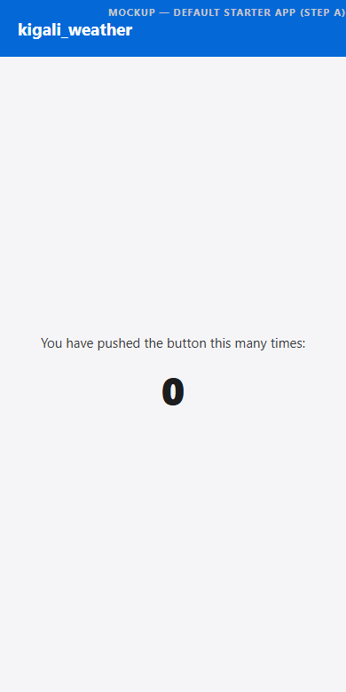
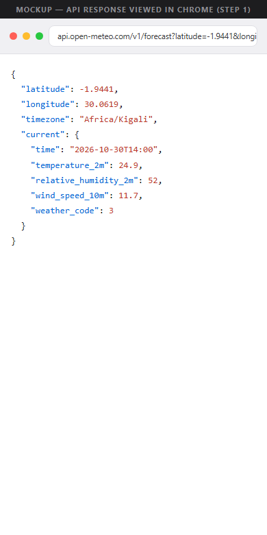
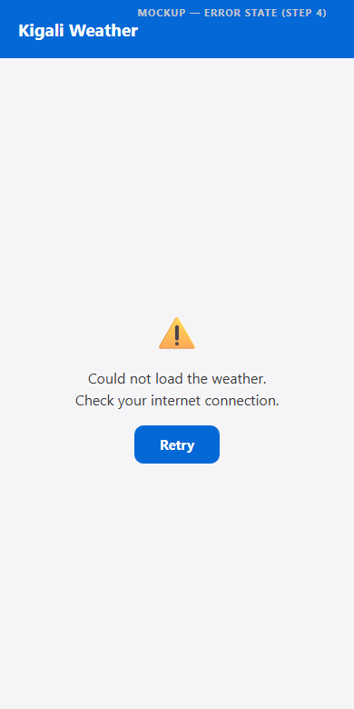
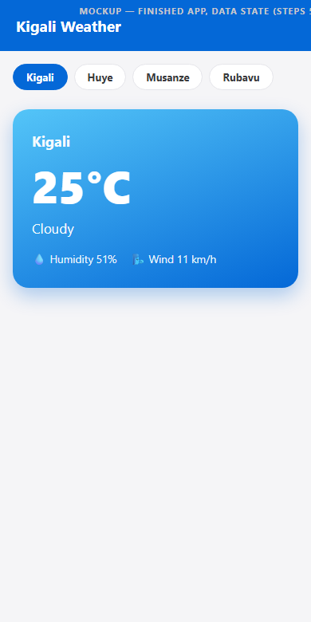

# Kigali Weather

A Flutter tutorial app built for Session 5 ("Data from the Internet") — a weather app for Kigali, Huye, Musanze, and Rubavu using the [Open-Meteo](https://open-meteo.com/) API, covering `async`/`await`, HTTP requests, JSON parsing, loading/error/data states, and remembering data with `shared_preferences`.

## Contents

- [`kigali-weather.html`](kigali-weather.html) — the full step-by-step build guide
- [`exam-review-notes.md`](exam-review-notes.md) — condensed concept notes
- [`Session5-Data-From-The-Internet.pptx`](Session5-Data-From-The-Internet.pptx) — the session slide deck

## Preview

> The screens below are mockup illustrations of each app state, not captures from a running build.

| Starter app | API response | No internet | Data loaded |
|---|---|---|---|
|  |  |  |  |
